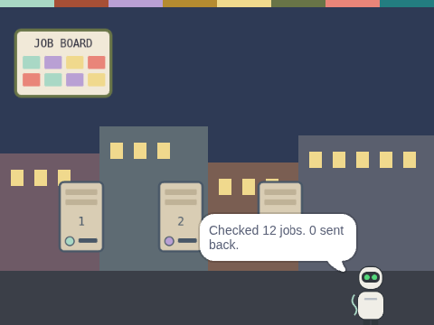

# The Idle Machine Lab: Scratch projects

**Starter and solution projects for a grades 3–5 computer lab year about sharing, networks and fair turns.**

> **CONCEPT / NOT FINAL.** A draft from Omega Compute, not yet piloted in a classroom.
> From *The Idle Machine Signal*. Created by **Rian L. Gabrielle**. Owner: **Omega Compute**.



This repository holds every Scratch task from *The Idle Machine Lab* curriculum: **17 weekly projects and the
capstone, *The Idle Machine Network***. Each one comes in two versions:

- **Starter** (`-starter.sb3`): what pupils open. It has the scene, the characters and yellow **TODO** notes next to
  the code that tell pupils what to build.
- **Solution** (`-solution.sb3`): a finished, working version for the teacher.

All art is original and made for this project. There are no Scratch Library sprites, photos or sounds.

## For teachers: getting started

1. Open Scratch: the free desktop app, or [scratch.mit.edu](https://scratch.mit.edu) → **Create**. **No account is
   needed**, and the curriculum never asks pupils to sign up.
2. Download this repository (green **Code** button → **Download ZIP**), or download only the `.sb3` files you need.
3. In Scratch, choose **File → Load from your computer** and pick a starter.
4. Pupils save their work to the class folder with **File → Save to your computer**.

Each project page below has screenshots, the pupils' TODO notes and a quick "how to check it works" test.

## The projects

| Week | Project | What it does |
|---|---|---|
| Week 2 | [In, Think, Out](docs/projects/w02-in-think-out.md) | Click Juno. She says hello, asks your name and answers you. |
| Week 4 | [Postcard Packets](docs/projects/w04-packets.md) | Juno sends a message one word at a time. Dex says "Got it!" for every packet. |
| Week 5 | [Bug Hunt](docs/projects/w05-bug-hunt.md) | A broken project with three bugs to find and fix. |
| Week 6 | [Packet Relay](docs/projects/w06-packet-relay.md) | Three friends pass a message along and send back a thank-you. |
| Week 7 | [Robot Route](docs/projects/w07-maze-route.md) | Write the steps that take Kip through the maze to the clinic. |
| Week 9 | [Loop It](docs/projects/w09-loop-shapes.md) | Draw a square with a loop, then remix it into a hexagon. |
| Week 10 | [Night Rota](docs/projects/w10-night-rota.md) | Four friends take turns watching the clinic server. |
| Week 11 | [Someone to Take Over](docs/projects/w11-handover.md) | Juno counts to 5 and hands over. Dex carries on from where she stopped. |
| Week 12 | [Share the Sum](docs/projects/w12-share-the-sum.md) | Three helpers each add two numbers. Kip adds up the total. |
| Week 14 | [Lights Out](docs/projects/w14-lights-out.md) | Compare a hub town with a web town when the hub goes dark. |
| Week 16 | [Neighbourhood Vote](docs/projects/w16-vote-counter.md) | Five neighbours vote. Rollo counts the votes and says which job goes first. |
| Week 20 | [Copy and Compare](docs/projects/w20-copy-compare.md) | Two copies of a ledger. Dex checks them line by line and finds the change. |
| Week 21 | [Check Numbers](docs/projects/w21-check-number.md) | Work out a check number for a word, using A=1 to Z=26. |
| Week 22 | [Ledger Keeper](docs/projects/w22-ledger-keeper.md) | Pia writes every trade in a shared ledger list. |
| Week 26 | [Code Machine](docs/projects/w26-code-machine.md) | A shift-code machine. Change the key, encode a message, then decode it. |
| Week 27 | [Password Door](docs/projects/w27-password-door.md) | A door that opens only for the right pretend password. |
| Week 29 | [Careful Helper](docs/projects/w29-careful-helper.md) | An SI helper that says "Please ask a grown-up first" when a request has private words. |
| 32–36 | [The Idle Machine Network](docs/projects/capstone-idle-machine-network.md) | Capstone: a job board, three idle machines, a checker, a machine that goes dark and a credits screen. |

Weeks follow the 36-week plan in the curriculum. Week 24's unit project is the finished *Ledger Keeper* from Week 22.

## Reading level and support

The TODO notes in the starters measure about **Flesch–Kincaid grade 2.7** overall (range 1.3 to 4.0 per project),
for pupils reading at about US grade 3–4. Read them aloud for younger or emerging readers. The curriculum's K–2
adaptations use the unplugged versions of these tasks.

## Safety and privacy

- No pupil accounts, no data collection, no sharing to the Scratch website is required.
- The *Password Door* uses **pretend passwords only**. Remind pupils never to type a real password into a project.
- The *Careful Helper* (an SI helper, Week 29) teaches pupils to "ask a grown-up first" before sharing private details.
- No real money, no prices and no crypto. Grown-ups: please do not buy crypto for or with children.
- The story is fiction. Any phone number on a story prop is a fictional prop number. It is not a number to call.

## Certification

Pupils who meet the bar can receive a printed **Certified Idle Machine Lab Graduate** certificate, signed by their
teacher. Nothing about the pupil is sent to anyone. See [CERTIFICATION.md](CERTIFICATION.md) for the requirements.

**For adults only:** Omega Compute plans a free Pewter offer linked to this certificate. Pewter's minimum age is 13, so
the offer is for **the school, the teacher, or a parent or guardian's own account, never the child**. It is not
shown in pupil or family materials. Amount, duration and terms are **TBD by Omega Compute**.

## For developers

The `.sb3` files are built from Python source, so they stay valid and match the curriculum.

```sh
npm install                 # scratch-parser, scratch-vm and scratch-storage, for the tests
python3 tools/projects.py   # rebuild every .sb3 (byte-identical on rebuild)
python3 tools/make_docs.py  # rebuild the teacher pages
npm test                    # validate every project
```

`npm test` checks each of the 36 files three ways:

1. **Schema:** `scratch-parser` validates `project.json` against the Scratch 3 schema.
2. **Loads:** `scratch-vm` loads the project, with storage attached, and every costume asset is present.
3. **Behaviour:** the project runs headless with scripted clicks, key presses and answers. **Solutions must pass.
   Starters must load but must not pass yet**, so pupils have real work to do.

| Path | What is there |
|---|---|
| `projects/<slug>/` | the starter and solution `.sb3` for each project |
| `projects/index.json` | project list (slug, week, title, summary) |
| `tools/sb3build.py` | a small Python library that writes Scratch 3 projects |
| `tools/art.py` | the original SVG characters, objects and backdrops |
| `tools/projects.py` | every project, starter and solution |
| `tools/make_docs.py` | writes `docs/projects/*.md` |
| `tests/` | the validator, the behaviour scenarios and the last report |
| `docs/img/` | stage screenshots rendered with scratch-vm and scratch-render |

## Licence

- **Code** (`tools/`, `tests/`, `.github/`): [Apache License 2.0](LICENSE).
- **Curriculum text, docs and art** (including the art and notes inside the `.sb3` files):
  [CC BY 4.0](LICENSE-CC-BY-4.0).
- No trademark rights are granted. Character names and likenesses, *The Idle Machine Signal* and *The Omegas* are
  reserved by Omega Compute. See [NOTICE](NOTICE).
- Standards are cited by code only, in the curriculum's standards map.

Scratch is a project of the Scratch Foundation, in collaboration with the Lifelong Kindergarten Group at the MIT
Media Lab. It is available for free at https://scratch.mit.edu. This repository is not an official Scratch product
and is not endorsed by the Scratch Foundation.

Contributing: [CONTRIBUTING.md](CONTRIBUTING.md) · Conduct: [CODE_OF_CONDUCT.md](CODE_OF_CONDUCT.md) ·
Security: [SECURITY.md](SECURITY.md)

The college course in the same series has its labs at
[OmegaComputes/decentralized-computing-labs](https://github.com/OmegaComputes/decentralized-computing-labs).

Contact: hello@omegacompute.com

© 2026 Omega Compute · Created by Rian L. Gabrielle
