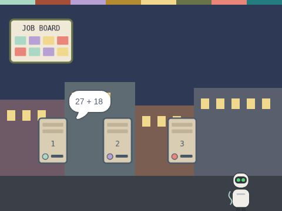
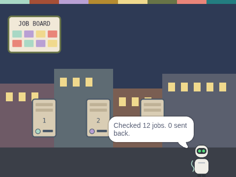

# The Idle Machine Network

**Capstone (Weeks 32–36)** · Idle Machine Lab · CONCEPT / NOT FINAL

> Capstone: a job board, three idle machines, a checker, a machine that goes dark and a credits screen.

| Starter (what pupils open) | Finished solution |
|---|---|
|  |  |

*Screenshots are real stage renders made with scratch-vm and scratch-render, after the green flag. Variable boxes and the editor are not shown.*

## Files

- Starter: [`projects/capstone-idle-machine-network/capstone-idle-machine-network-starter.sb3`](../../projects/capstone-idle-machine-network/capstone-idle-machine-network-starter.sb3)
- Solution: [`projects/capstone-idle-machine-network/capstone-idle-machine-network-solution.sb3`](../../projects/capstone-idle-machine-network/capstone-idle-machine-network-solution.sb3) (teacher copy; hand out after the lesson if you like)

Open in Scratch: **File → Load from your computer**. No Scratch account is needed.

## What pupils do

These notes are inside the starter, as yellow comments next to the code:

**Machine 2**

> TODO: Machine 2 needs a brain!
>
> Copy Machine 1's "when I receive [open]" script here. A machine only takes a job when it is idle.

**Machine 2**

> TODO (Week 35): When SPACE is pressed, make this machine go dark:
> "stop [other scripts in sprite]", set [dark] to "yes", switch to the "dark" costume.
> If it was busy (idle = no), put its job back on the job lists first.
>
> Do the other machines still finish every job?

**Machine 3**

> TODO: Machine 3 needs a brain!
>
> Copy Machine 1's "when I receive [open]" script here. A machine only takes a job when it is idle.

**Checker**

> TODO (Week 34): The Checker does each job again.
>
> While there are items in [check a]: add item 1 of [check a] and item 1 of [check b]. If it equals item 1 of [check answer], change [checked] by 1. If not, change [mismatches] by 1 and put the numbers back on the job lists.
> Then delete item 1 of all three check lists.

## How to check it works

Green flag, then press **SPACE** while the machines work. Machine 2 goes dark, but the Checker should still say **Checked 12 jobs. 0 sent back.** Press **C** for the credits.

The same check runs automatically in `tests/validate.js`.

## In the curriculum

See the Capstone (Weeks 32–36) lesson in *The Idle Machine Lab* (Semester 2 plan). Standards are listed by code only in the curriculum's standards map.

---

Created by Rian L. Gabrielle · © Omega Compute · Text and art CC BY 4.0 · Code Apache-2.0 · Scratch is a project of the Scratch Foundation; this is not an official Scratch product.
