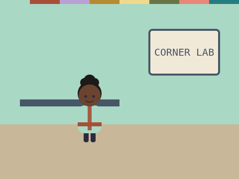

# In, Think, Out

**Week 2** · Idle Machine Lab · CONCEPT / NOT FINAL

> Click Juno. She says hello, asks your name and answers you.

| Starter (what pupils open) | Finished solution |
|---|---|
|  |  |

*Screenshots are real stage renders made with scratch-vm and scratch-render, after the green flag. Variable boxes and the editor are not shown.*

## Files

- Starter: [`projects/w02-in-think-out/w02-in-think-out-starter.sb3`](../../projects/w02-in-think-out/w02-in-think-out-starter.sb3)
- Solution: [`projects/w02-in-think-out/w02-in-think-out-solution.sb3`](../../projects/w02-in-think-out/w02-in-think-out-solution.sb3) (teacher copy; hand out after the lesson if you like)

Open in Scratch: **File → Load from your computer**. No Scratch account is needed.

## What pupils do

These notes are inside the starter, as yellow comments next to the code:

**Juno**

> TODO 1: Add an "ask and wait" block. Make Juno ask, "What is your name?"
>
> TODO 2: Add a "say" block. Put a "join" block inside it, so Juno says "Hi" and then your answer.
>
> The click is the INPUT. Your blocks are the THINKING. The speech bubble is the OUTPUT.

## How to check it works

Click Juno. Type **Ana**. Juno should say **Hi Ana!**

The same check runs automatically in `tests/validate.js`.

## In the curriculum

See the Week 2 lesson in *The Idle Machine Lab* (Semester 1 plan). Standards are listed by code only in the curriculum's standards map.

---

Created by Rian L. Gabrielle · © Omega Compute · Text and art CC BY 4.0 · Code Apache-2.0 · Scratch is a project of the Scratch Foundation; this is not an official Scratch product.
