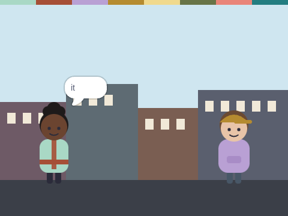
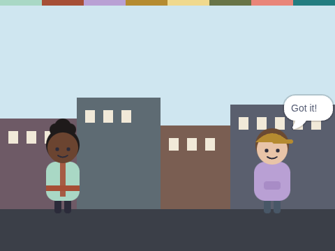

# Postcard Packets

**Week 4** · Idle Machine Lab · CONCEPT / NOT FINAL

> Juno sends a message one word at a time. Dex says "Got it!" for every packet.

| Starter (what pupils open) | Finished solution |
|---|---|
|  |  |

*Screenshots are real stage renders made with scratch-vm and scratch-render, after the green flag. Variable boxes and the editor are not shown.*

## Files

- Starter: [`projects/w04-packets/w04-packets-starter.sb3`](../../projects/w04-packets/w04-packets-starter.sb3)
- Solution: [`projects/w04-packets/w04-packets-solution.sb3`](../../projects/w04-packets/w04-packets-solution.sb3) (teacher copy; hand out after the lesson if you like)

Open in Scratch: **File → Load from your computer**. No Scratch account is needed.

## What pupils do

These notes are inside the starter, as yellow comments next to the code:

**Dex**

> TODO: Dex needs to listen for each packet.
>
> 1. Drag out "when I receive [packet]".
> 2. Under it, add "change [packets got] by 1".
> 3. Then add "say [Got it!] for 0.5 seconds".
>
> Test it: the counter should end at 3.

## How to check it works

Click the green flag. Dex should say **Got it!** three times, and **packets got** should reach 3.

The same check runs automatically in `tests/validate.js`.

## In the curriculum

See the Week 4 lesson in *The Idle Machine Lab* (Semester 1 plan). Standards are listed by code only in the curriculum's standards map.

---

Created by Rian L. Gabrielle · © Omega Compute · Text and art CC BY 4.0 · Code Apache-2.0 · Scratch is a project of the Scratch Foundation; this is not an official Scratch product.
