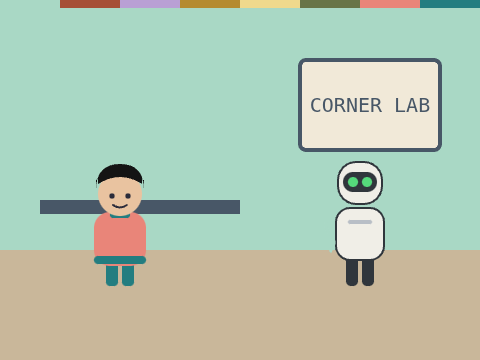
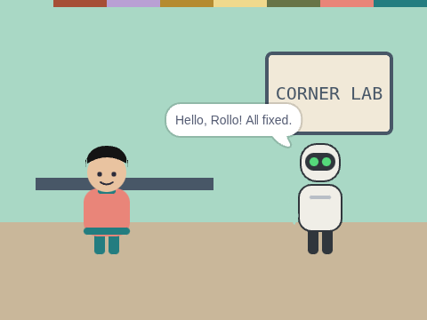

# Bug Hunt

**Week 5** · Idle Machine Lab · CONCEPT / NOT FINAL

> A broken project with three bugs to find and fix.

| Starter (what pupils open) | Finished solution |
|---|---|
|  |  |

*Screenshots are real stage renders made with scratch-vm and scratch-render, after the green flag. Variable boxes and the editor are not shown.*

## Files

- Starter: [`projects/w05-bug-hunt/w05-bug-hunt-starter.sb3`](../../projects/w05-bug-hunt/w05-bug-hunt-starter.sb3)
- Solution: [`projects/w05-bug-hunt/w05-bug-hunt-solution.sb3`](../../projects/w05-bug-hunt/w05-bug-hunt-solution.sb3) (teacher copy; hand out after the lesson if you like)

Open in Scratch: **File → Load from your computer**. No Scratch account is needed.

## What pupils do

These notes are inside the starter, as yellow comments next to the code:

**Stage**

> BUG HUNT! This project has 3 bugs.
>
> What SHOULD happen: click the green flag. Rollo says hello. One second later, Kip says hello back.
>
> Use the checklist: What should happen? What does happen? Where does it go wrong? Change ONE thing. Test again.
>
> Hint: look at how Rollo's script starts, how long it waits, and the name of the message.

## How to check it works

Click the green flag. Kip should say **Hello, Rollo! All fixed.**

The same check runs automatically in `tests/validate.js`.

## In the curriculum

See the Week 5 lesson in *The Idle Machine Lab* (Semester 1 plan). Standards are listed by code only in the curriculum's standards map.

---

Created by Rian L. Gabrielle · © Omega Compute · Text and art CC BY 4.0 · Code Apache-2.0 · Scratch is a project of the Scratch Foundation; this is not an official Scratch product.
