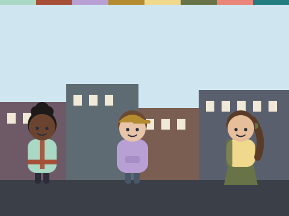
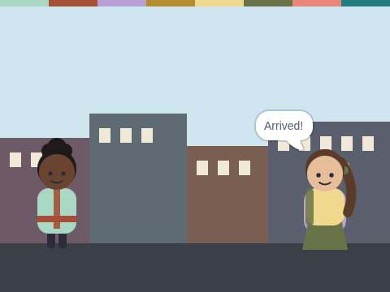

# Packet Relay

**Week 6** · Idle Machine Lab · CONCEPT / NOT FINAL

> Three friends pass a message along and send back a thank-you.

| Starter (what pupils open) | Finished solution |
|---|---|
|  |  |

*Screenshots are real stage renders made with scratch-vm and scratch-render, after the green flag. Variable boxes and the editor are not shown.*

## Files

- Starter: [`projects/w06-packet-relay/w06-packet-relay-starter.sb3`](../../projects/w06-packet-relay/w06-packet-relay-starter.sb3)
- Solution: [`projects/w06-packet-relay/w06-packet-relay-solution.sb3`](../../projects/w06-packet-relay/w06-packet-relay-solution.sb3) (teacher copy; hand out after the lesson if you like)

Open in Scratch: **File → Load from your computer**. No Scratch account is needed.

## What pupils do

These notes are inside the starter, as yellow comments next to the code:

**Dex**

> TODO for Dex (Sprite 2):
> 1. "when I receive [to2]"
> 2. "glide 1 secs to [Pia]"
> 3. "say [Hello!] for 1 seconds"
> 4. "broadcast [to3]"

**Pia**

> TODO for Pia (Sprite 3):
> 1. "when I receive [to3]"
> 2. "say [Arrived!] for 1 seconds"
> 3. "broadcast [ack]" so Juno knows it got there.

## How to check it works

Click the green flag. Pia should say **Arrived!** and then Juno should say **Thank you!**

The same check runs automatically in `tests/validate.js`.

## In the curriculum

See the Week 6 lesson in *The Idle Machine Lab* (Semester 1 plan). Standards are listed by code only in the curriculum's standards map.

---

Created by Rian L. Gabrielle · © Omega Compute · Text and art CC BY 4.0 · Code Apache-2.0 · Scratch is a project of the Scratch Foundation; this is not an official Scratch product.
