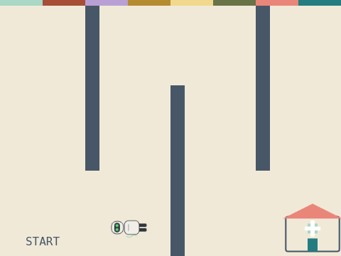
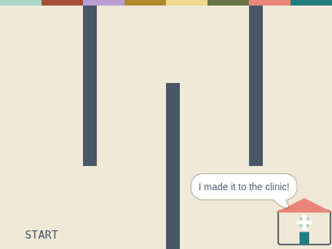

# Robot Route

**Week 7** · Idle Machine Lab · CONCEPT / NOT FINAL

> Write the steps that take Kip through the maze to the clinic.

| Starter (what pupils open) | Finished solution |
|---|---|
|  |  |

*Screenshots are real stage renders made with scratch-vm and scratch-render, after the green flag. Variable boxes and the editor are not shown.*

## Files

- Starter: [`projects/w07-maze-route/w07-maze-route-starter.sb3`](../../projects/w07-maze-route/w07-maze-route-starter.sb3)
- Solution: [`projects/w07-maze-route/w07-maze-route-solution.sb3`](../../projects/w07-maze-route/w07-maze-route-solution.sb3) (teacher copy; hand out after the lesson if you like)

Open in Scratch: **File → Load from your computer**. No Scratch account is needed.

## What pupils do

These notes are inside the starter, as yellow comments next to the code:

**Kip**

> TODO: Finish the route to the clinic.
>
> Kip has gone right and turned up. Now add "move" and "turn" blocks to get past each wall.
>
> Tip: one square on the floor is about 60 steps. Test after every two blocks.
>
> Stretch: can you find a route with fewer blocks?

## How to check it works

Click the green flag. Kip should reach the clinic without crossing a wall and say **I made it to the clinic!**

The same check runs automatically in `tests/validate.js`.

## In the curriculum

See the Week 7 lesson in *The Idle Machine Lab* (Semester 1 plan). Standards are listed by code only in the curriculum's standards map.

---

Created by Rian L. Gabrielle · © Omega Compute · Text and art CC BY 4.0 · Code Apache-2.0 · Scratch is a project of the Scratch Foundation; this is not an official Scratch product.
