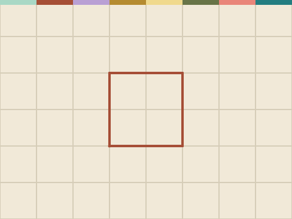

# Loop It

**Week 9** · Idle Machine Lab · CONCEPT / NOT FINAL

> Draw a square with a loop, then remix it into a hexagon.

| Starter (what pupils open) | Finished solution |
|---|---|
|  |  |

*Screenshots are real stage renders made with scratch-vm and scratch-render, after the green flag. Variable boxes and the editor are not shown.*

## Files

- Starter: [`projects/w09-loop-shapes/w09-loop-shapes-starter.sb3`](../../projects/w09-loop-shapes/w09-loop-shapes-starter.sb3)
- Solution: [`projects/w09-loop-shapes/w09-loop-shapes-solution.sb3`](../../projects/w09-loop-shapes/w09-loop-shapes-solution.sb3) (teacher copy; hand out after the lesson if you like)

Open in Scratch: **File → Load from your computer**. No Scratch account is needed.

## What pupils do

These notes are inside the starter, as yellow comments next to the code:

**Pen**

> TODO 1: This script copies the same two blocks 4 times. Rewrite it with ONE "repeat 4" loop.
>
> TODO 2: Make a new script: "when [h] key pressed". Use "repeat 6", "move 80" and "turn 60" to draw a hexagon.
>
> Pen blocks come from the Pen extension (bottom-left button).

## How to check it works

Click the green flag to draw a square. Press **H** to draw a hexagon. The pen script should use a **repeat** loop.

The same check runs automatically in `tests/validate.js`.

## In the curriculum

See the Week 9 lesson in *The Idle Machine Lab* (Semester 1 plan). Standards are listed by code only in the curriculum's standards map.

---

Created by Rian L. Gabrielle · © Omega Compute · Text and art CC BY 4.0 · Code Apache-2.0 · Scratch is a project of the Scratch Foundation; this is not an official Scratch product.
