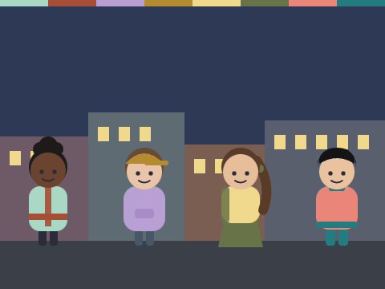
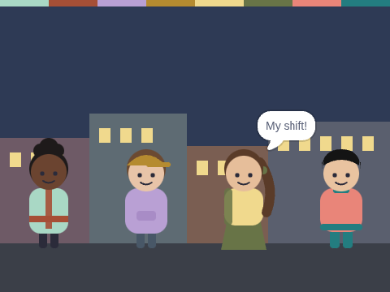

# Night Rota

**Week 10** · Idle Machine Lab · CONCEPT / NOT FINAL

> Four friends take turns watching the clinic server.

| Starter (what pupils open) | Finished solution |
|---|---|
|  |  |

*Screenshots are real stage renders made with scratch-vm and scratch-render, after the green flag. Variable boxes and the editor are not shown.*

## Files

- Starter: [`projects/w10-night-rota/w10-night-rota-starter.sb3`](../../projects/w10-night-rota/w10-night-rota-starter.sb3)
- Solution: [`projects/w10-night-rota/w10-night-rota-solution.sb3`](../../projects/w10-night-rota/w10-night-rota-solution.sb3) (teacher copy; hand out after the lesson if you like)

Open in Scratch: **File → Load from your computer**. No Scratch account is needed.

## What pupils do

These notes are inside the starter, as yellow comments next to the code:

**Dex**

> TODO: Drag Juno's script onto Dex, Pia and Rollo.
>
> Then fix the number in "turn = 1". Dex needs 2. Pia needs 3. Rollo needs 4.
>
> Take turns. Eat first!

## How to check it works

Click the green flag. Juno, Dex, Pia and Rollo should each say **My shift!** in turn.

The same check runs automatically in `tests/validate.js`.

## In the curriculum

See the Week 10 lesson in *The Idle Machine Lab* (Semester 1 plan). Standards are listed by code only in the curriculum's standards map.

---

Created by Rian L. Gabrielle · © Omega Compute · Text and art CC BY 4.0 · Code Apache-2.0 · Scratch is a project of the Scratch Foundation; this is not an official Scratch product.
