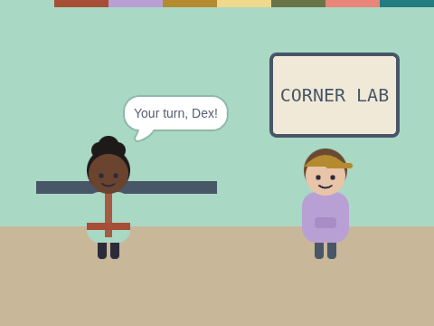

# Someone to Take Over

**Week 11** · Idle Machine Lab · CONCEPT / NOT FINAL

> Juno counts to 5 and hands over. Dex carries on from where she stopped.

| Starter (what pupils open) | Finished solution |
|---|---|
|  |  |

*Screenshots are real stage renders made with scratch-vm and scratch-render, after the green flag. Variable boxes and the editor are not shown.*

## Files

- Starter: [`projects/w11-handover/w11-handover-starter.sb3`](../../projects/w11-handover/w11-handover-starter.sb3)
- Solution: [`projects/w11-handover/w11-handover-solution.sb3`](../../projects/w11-handover/w11-handover-solution.sb3) (teacher copy; hand out after the lesson if you like)

Open in Scratch: **File → Load from your computer**. No Scratch account is needed.

## What pupils do

These notes are inside the starter, as yellow comments next to the code:

**Dex**

> TODO: Dex takes over the job.
>
> 1. "when I receive [take over]"
> 2. A "repeat 5" loop with "change [count] by 1" and "say (count) for 0.4 seconds".
>
> Dex should start from 6, because the count is shared. A good handover says where you stopped!

## How to check it works

Click the green flag. Juno counts to 5, then Dex carries on and says **Done! I stopped at 10**.

The same check runs automatically in `tests/validate.js`.

## In the curriculum

See the Week 11 lesson in *The Idle Machine Lab* (Semester 1 plan). Standards are listed by code only in the curriculum's standards map.

---

Created by Rian L. Gabrielle · © Omega Compute · Text and art CC BY 4.0 · Code Apache-2.0 · Scratch is a project of the Scratch Foundation; this is not an official Scratch product.
