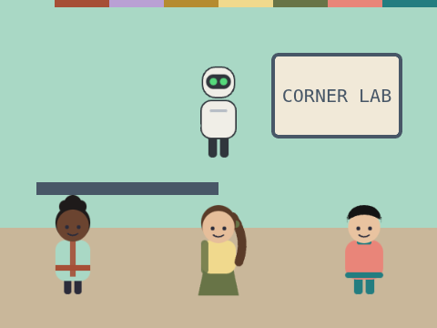
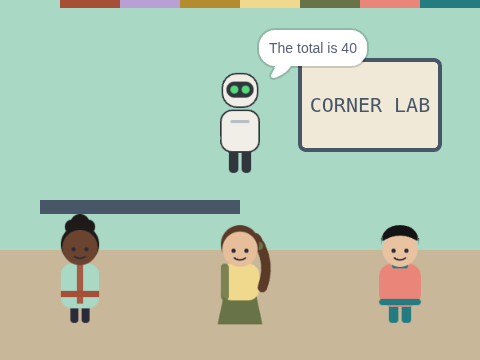

# Share the Sum

**Week 12** · Idle Machine Lab · CONCEPT / NOT FINAL

> Three helpers each add two numbers. Kip adds up the total.

| Starter (what pupils open) | Finished solution |
|---|---|
|  |  |

*Screenshots are real stage renders made with scratch-vm and scratch-render, after the green flag. Variable boxes and the editor are not shown.*

## Files

- Starter: [`projects/w12-share-the-sum/w12-share-the-sum-starter.sb3`](../../projects/w12-share-the-sum/w12-share-the-sum-starter.sb3)
- Solution: [`projects/w12-share-the-sum/w12-share-the-sum-solution.sb3`](../../projects/w12-share-the-sum/w12-share-the-sum-solution.sb3) (teacher copy; hand out after the lesson if you like)

Open in Scratch: **File → Load from your computer**. No Scratch account is needed.

## What pupils do

These notes are inside the starter, as yellow comments next to the code:

**Pia**

> TODO for Pia: copy Juno's script here. Change the numbers to 7 + 8.
>
> Each helper adds its answer to the shared total, then adds 1 to "helpers done".

**Rollo**

> TODO for Rollo: copy Juno's script here. Change the numbers to 10 + 6.
>
> Each helper adds its answer to the shared total, then adds 1 to "helpers done".

## How to check it works

Click the green flag. Kip should say **The total is 40**.

The same check runs automatically in `tests/validate.js`.

## In the curriculum

See the Week 12 lesson in *The Idle Machine Lab* (Semester 1 plan). Standards are listed by code only in the curriculum's standards map.

---

Created by Rian L. Gabrielle · © Omega Compute · Text and art CC BY 4.0 · Code Apache-2.0 · Scratch is a project of the Scratch Foundation; this is not an official Scratch product.
