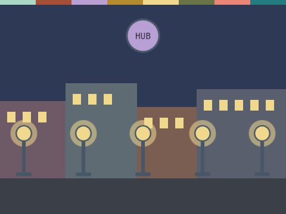

# Lights Out

**Week 14** · Idle Machine Lab · CONCEPT / NOT FINAL

> Compare a hub town with a web town when the hub goes dark.

| Starter (what pupils open) | Finished solution |
|---|---|
|  |  |

*Screenshots are real stage renders made with scratch-vm and scratch-render, after the green flag. Variable boxes and the editor are not shown.*

## Files

- Starter: [`projects/w14-lights-out/w14-lights-out-starter.sb3`](../../projects/w14-lights-out/w14-lights-out-starter.sb3)
- Solution: [`projects/w14-lights-out/w14-lights-out-solution.sb3`](../../projects/w14-lights-out/w14-lights-out-solution.sb3) (teacher copy; hand out after the lesson if you like)

Open in Scratch: **File → Load from your computer**. No Scratch account is needed.

## What pupils do

These notes are inside the starter, as yellow comments next to the code:

**Lamp 1**

> TODO: When the hub goes dark, what happens to this lamp?
>
> Add "when I receive [hub down]". Inside "if <(network) = [hub]>", set power to 0 and switch to the "off" costume.
>
> In a web town, the lamp has other links, so it stays on. Then copy your script to every lamp.

## How to check it works

Green flag, then press **SPACE**: in the hub town every lamp goes dark. Press **W** to switch to the web town, then **SPACE** again: the lamps stay lit.

The same check runs automatically in `tests/validate.js`.

## In the curriculum

See the Week 14 lesson in *The Idle Machine Lab* (Semester 1 plan). Standards are listed by code only in the curriculum's standards map.

---

Created by Rian L. Gabrielle · © Omega Compute · Text and art CC BY 4.0 · Code Apache-2.0 · Scratch is a project of the Scratch Foundation; this is not an official Scratch product.
