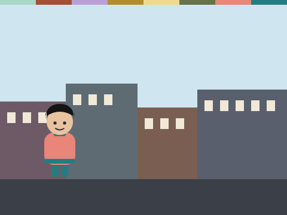
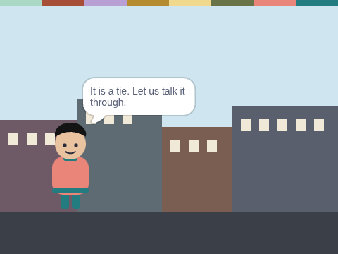

# Neighbourhood Vote

**Week 16** · Idle Machine Lab · CONCEPT / NOT FINAL

> Five neighbours vote. Rollo counts the votes and says which job goes first.

| Starter (what pupils open) | Finished solution |
|---|---|
|  |  |

*Screenshots are real stage renders made with scratch-vm and scratch-render, after the green flag. Variable boxes and the editor are not shown.*

## Files

- Starter: [`projects/w16-vote-counter/w16-vote-counter-starter.sb3`](../../projects/w16-vote-counter/w16-vote-counter-starter.sb3)
- Solution: [`projects/w16-vote-counter/w16-vote-counter-solution.sb3`](../../projects/w16-vote-counter/w16-vote-counter-solution.sb3) (teacher copy; hand out after the lesson if you like)

Open in Scratch: **File → Load from your computer**. No Scratch account is needed.

## What pupils do

These notes are inside the starter, as yellow comments next to the code:

**Rollo**

> TODO 1: Reading votes are not counted yet! Add an "if" for "reading".
>
> TODO 2: Set "reading votes" and "total votes" to 0 at the start. Add 1 to "total votes" for every vote.
>
> TODO 3 (Week 17): After the loop, use "if ... else" with ">" to say which job won, or say it is a tie.

## How to check it works

Green flag. Type the five votes: clinic, reading, clinic, clinic, reading. Rollo should say **Clinic first! 3 votes.**

The same check runs automatically in `tests/validate.js`.

## In the curriculum

See the Week 16 lesson in *The Idle Machine Lab* (Semester 1 plan). Standards are listed by code only in the curriculum's standards map.

---

Created by Rian L. Gabrielle · © Omega Compute · Text and art CC BY 4.0 · Code Apache-2.0 · Scratch is a project of the Scratch Foundation; this is not an official Scratch product.
