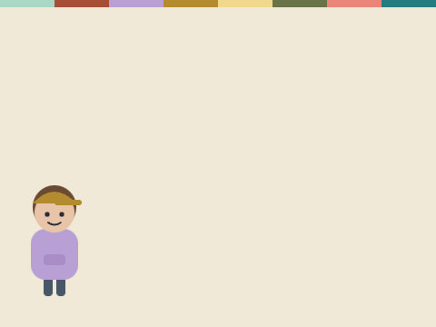
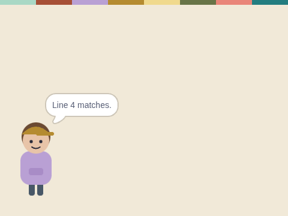

# Copy and Compare

**Week 20** · Idle Machine Lab · CONCEPT / NOT FINAL

> Two copies of a ledger. Dex checks them line by line and finds the change.

| Starter (what pupils open) | Finished solution |
|---|---|
|  |  |

*Screenshots are real stage renders made with scratch-vm and scratch-render, after the green flag. Variable boxes and the editor are not shown.*

## Files

- Starter: [`projects/w20-copy-compare/w20-copy-compare-starter.sb3`](../../projects/w20-copy-compare/w20-copy-compare-starter.sb3)
- Solution: [`projects/w20-copy-compare/w20-copy-compare-solution.sb3`](../../projects/w20-copy-compare/w20-copy-compare-solution.sb3) (teacher copy; hand out after the lesson if you like)

Open in Scratch: **File → Load from your computer**. No Scratch account is needed.

## What pupils do

These notes are inside the starter, as yellow comments next to the code:

**Dex**

> TODO: Check every line.
>
> 1. Use "repeat (length of [copy A])".
> 2. Inside, use "if <(item (line) of [copy A]) = (item (line) of [copy B])> then ... else ...".
> 3. If they are different, add 1 to [differences].
> 4. Add 1 to [line] each time round.
>
> Many copies help us spot a change!

## How to check it works

Click the green flag. Dex should say **Line 3 is different!** and **differences** should be 1.

The same check runs automatically in `tests/validate.js`.

## In the curriculum

See the Week 20 lesson in *The Idle Machine Lab* (Semester 2 plan). Standards are listed by code only in the curriculum's standards map.

---

Created by Rian L. Gabrielle · © Omega Compute · Text and art CC BY 4.0 · Code Apache-2.0 · Scratch is a project of the Scratch Foundation; this is not an official Scratch product.
