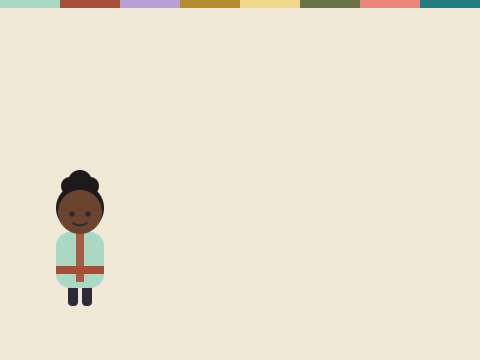
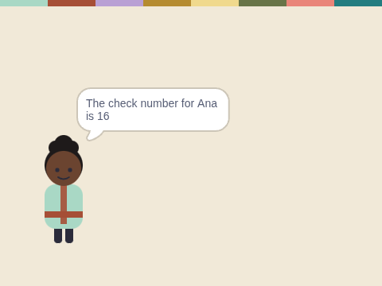

# Check Numbers

**Week 21** · Idle Machine Lab · CONCEPT / NOT FINAL

> Work out a check number for a word, using A=1 to Z=26.

| Starter (what pupils open) | Finished solution |
|---|---|
|  |  |

*Screenshots are real stage renders made with scratch-vm and scratch-render, after the green flag. Variable boxes and the editor are not shown.*

## Files

- Starter: [`projects/w21-check-number/w21-check-number-starter.sb3`](../../projects/w21-check-number/w21-check-number-starter.sb3)
- Solution: [`projects/w21-check-number/w21-check-number-solution.sb3`](../../projects/w21-check-number/w21-check-number-solution.sb3) (teacher copy; hand out after the lesson if you like)

Open in Scratch: **File → Load from your computer**. No Scratch account is needed.

## What pupils do

These notes are inside the starter, as yellow comments next to the code:

**Juno**

> TODO: Add up the letter numbers.
>
> Use "repeat (length of (word))". Inside it:
> - change [check number] by (item # of (letter (i) of (word)) in [alphabet])
> - change [i] by 1
>
> Then say the check number. CAT should give 24.

## How to check it works

Green flag. Type **CAT**. The check number should be **24** (3 + 1 + 20).

The same check runs automatically in `tests/validate.js`.

## In the curriculum

See the Week 21 lesson in *The Idle Machine Lab* (Semester 2 plan). Standards are listed by code only in the curriculum's standards map.

---

Created by Rian L. Gabrielle · © Omega Compute · Text and art CC BY 4.0 · Code Apache-2.0 · Scratch is a project of the Scratch Foundation; this is not an official Scratch product.
