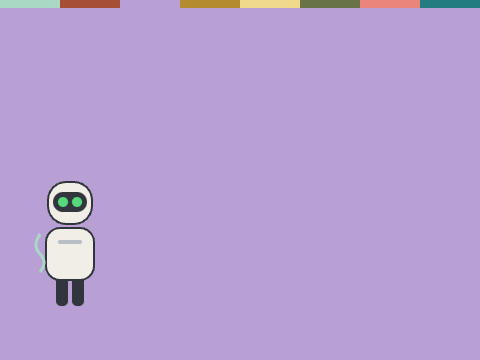

# Code Machine

**Week 26** · Idle Machine Lab · CONCEPT / NOT FINAL

> A shift-code machine. Change the key, encode a message, then decode it.

| Starter (what pupils open) | Finished solution |
|---|---|
|  |  |

*Screenshots are real stage renders made with scratch-vm and scratch-render, after the green flag. Variable boxes and the editor are not shown.*

## Files

- Starter: [`projects/w26-code-machine/w26-code-machine-starter.sb3`](../../projects/w26-code-machine/w26-code-machine-starter.sb3)
- Solution: [`projects/w26-code-machine/w26-code-machine-solution.sb3`](../../projects/w26-code-machine/w26-code-machine-solution.sb3) (teacher copy; hand out after the lesson if you like)

Open in Scratch: **File → Load from your computer**. No Scratch account is needed.

## What pupils do

These notes are inside the starter, as yellow comments next to the code:

**Kip**

> TODO: Build the decode button.
>
> 1. Right-click the "when [e] key pressed" script and choose Duplicate.
> 2. Change the key to [d].
> 3. Decoding goes backwards, so change "1 x (key)" to "-1 x (key)".
>
> Test: encode HELLO with key 3. You get KHOOR. Decode KHOOR to get HELLO back.

## How to check it works

Press **E** and type **HELLO WORLD**: Kip says **KHOOR ZRUOG**. Press **D** and type **KHOOR**: Kip says **HELLO**.

The same check runs automatically in `tests/validate.js`.

## In the curriculum

See the Week 26 lesson in *The Idle Machine Lab* (Semester 2 plan). Standards are listed by code only in the curriculum's standards map.

---

Created by Rian L. Gabrielle · © Omega Compute · Text and art CC BY 4.0 · Code Apache-2.0 · Scratch is a project of the Scratch Foundation; this is not an official Scratch product.
