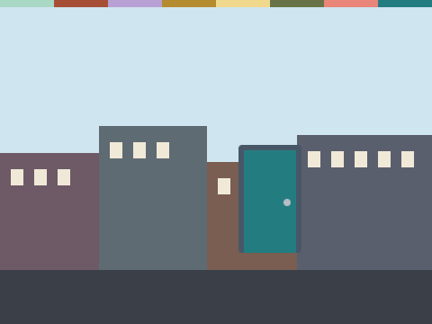

# Password Door

**Week 27** · Idle Machine Lab · CONCEPT / NOT FINAL

> A door that opens only for the right pretend password.

| Starter (what pupils open) | Finished solution |
|---|---|
|  |  |

*Screenshots are real stage renders made with scratch-vm and scratch-render, after the green flag. Variable boxes and the editor are not shown.*

## Files

- Starter: [`projects/w27-password-door/w27-password-door-starter.sb3`](../../projects/w27-password-door/w27-password-door-starter.sb3)
- Solution: [`projects/w27-password-door/w27-password-door-solution.sb3`](../../projects/w27-password-door/w27-password-door-solution.sb3) (teacher copy; hand out after the lesson if you like)

Open in Scratch: **File → Load from your computer**. No Scratch account is needed.

## What pupils do

These notes are inside the starter, as yellow comments next to the code:

**Door**

> TODO: Oops! This door opens for ANY answer.
>
> Use "if <(answer) = (secret)> then ... else ...". Open the door only when the answer matches. Otherwise say "Sorry, that is not it."
>
> Think: why should a real password never be shown on the screen?

## How to check it works

Click the door and type **1234**: it stays shut. Click again and type **lamp-river-pickle**: it opens. (Pretend passwords only.)

The same check runs automatically in `tests/validate.js`.

## In the curriculum

See the Week 27 lesson in *The Idle Machine Lab* (Semester 2 plan). Standards are listed by code only in the curriculum's standards map.

---

Created by Rian L. Gabrielle · © Omega Compute · Text and art CC BY 4.0 · Code Apache-2.0 · Scratch is a project of the Scratch Foundation; this is not an official Scratch product.
