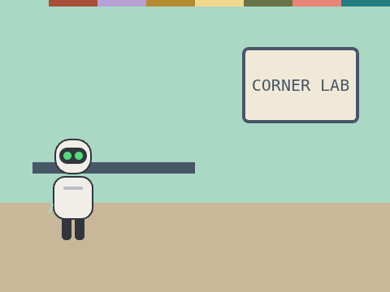

# Careful Helper

**Week 29** · Idle Machine Lab · CONCEPT / NOT FINAL

> An SI helper that says "Please ask a grown-up first" when a request has private words.

| Starter (what pupils open) | Finished solution |
|---|---|
|  |  |

*Screenshots are real stage renders made with scratch-vm and scratch-render, after the green flag. Variable boxes and the editor are not shown.*

## Files

- Starter: [`projects/w29-careful-helper/w29-careful-helper-starter.sb3`](../../projects/w29-careful-helper/w29-careful-helper-starter.sb3)
- Solution: [`projects/w29-careful-helper/w29-careful-helper-solution.sb3`](../../projects/w29-careful-helper/w29-careful-helper-solution.sb3) (teacher copy; hand out after the lesson if you like)

Open in Scratch: **File → Load from your computer**. No Scratch account is needed.

## What pupils do

These notes are inside the starter, as yellow comments next to the code:

**Kip**

> TODO: Kip says yes to everything! Make him careful.
>
> 1. Look through the [private words] list with "repeat" and "item (i) of [private words]".
> 2. If the answer contains a private word, set [found] to 1.
> 3. If found = 1, say "Please ask a grown-up first." Otherwise say "Happy to help!"

## How to check it works

Click Kip and type **here is my address**: Kip says **Please ask a grown-up first.** Click again and type **a fun fact about owls**: Kip is happy to help.

The same check runs automatically in `tests/validate.js`.

## In the curriculum

See the Week 29 lesson in *The Idle Machine Lab* (Semester 2 plan). Standards are listed by code only in the curriculum's standards map.

---

Created by Rian L. Gabrielle · © Omega Compute · Text and art CC BY 4.0 · Code Apache-2.0 · Scratch is a project of the Scratch Foundation; this is not an official Scratch product.
